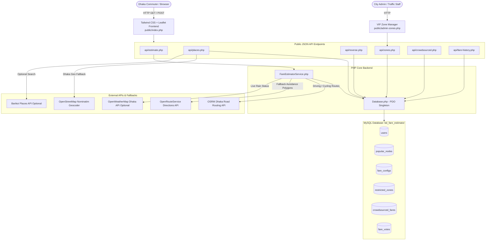
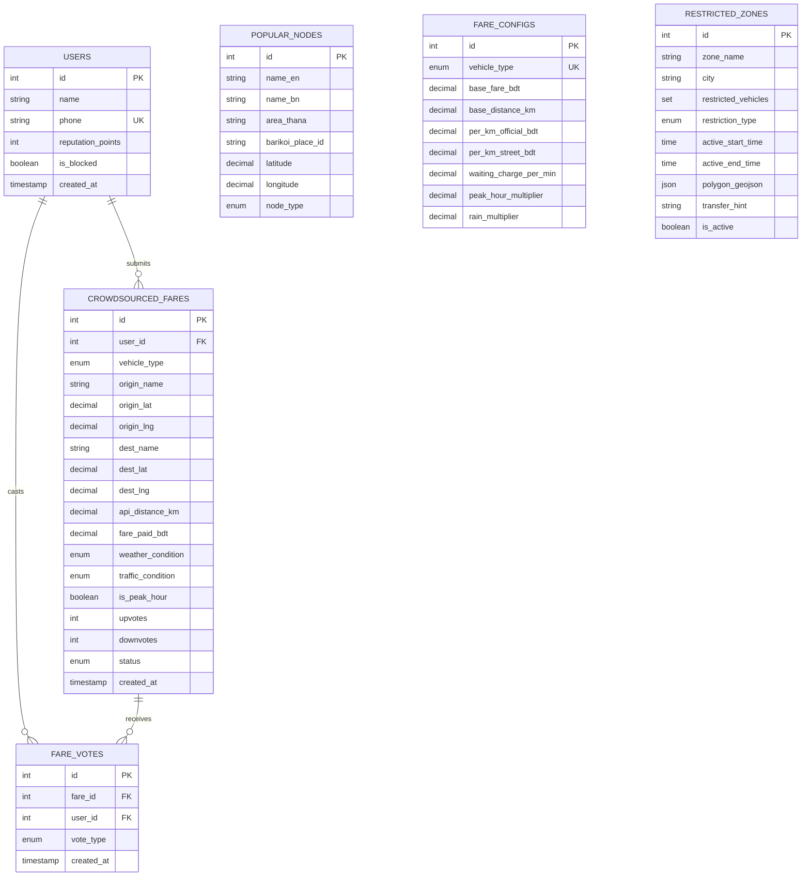

# BharaKoto? (ভাড়াকতো) - BD CNG, Rickshaw & Commuter Fare Estimator

[](https://www.php.net/)
[](https://www.mysql.com/)
[](https://leafletjs.com/)
[](https://www.openstreetmap.org/)
[](https://tailwindcss.com/)
[](LICENSE)

**BharaKoto? (ভাড়াকতো)** is a full-stack web application and algorithmic transit engine designed for commuters in **Dhaka, Bangladesh**. It calculates realistic street fares, official meter rates, route geometries, traffic/rain surges, and DMP (Dhaka Metropolitan Police) VIP arterial road bans for non-motorized and three-wheeler vehicles.

---

## 📋 Table of Contents
1. [The Problem in Dhaka](#-the-problem-in-dhaka)
2. [Key Features](#-key-features)
3. [System Architecture](#-system-architecture)
4. [Project Structure](#-project-structure)
5. [Database Schema & Seed Data](#-database-schema--seed-data)
6. [Fare Calculation & Economic Model](#-fare-calculation--economic-model)
7. [Official DMP VIP Bans & Flyover Restrictions](#-official-dmp-vip-bans--flyover-restrictions)
8. [REST API Documentation](#-rest-api-documentation)
9. [Setup & Installation](#-setup--installation)
10. [Admin VIP Zone Manager](#-admin-vip-zone-manager)
11. [Troubleshooting & FAQs](#-troubleshooting--faqs)

---

## 🚦 The Problem in Dhaka

Commuters in Dhaka deal with unpredictable, arbitrary transportation pricing every day:
- **No Meters on Rickshaws:** Pedal and battery rickshaws have no meters; rates are verbally negotiated on the street ("Mama, koto jaben?").
- **CNG Auto-Rickshaw Meter Refusal:** Despite government-mandated meter rates (BRTA), CNG drivers frequently demand fixed, inflated contract fares (*Chukti*), especially in peak hours or bad weather.
- **Dynamic Surges:** Commuters face steep price hikes during Dhaka's intense morning (08:00–10:30) and evening (17:00–20:30) rush hours, as well as during sudden monsoon downpours and waterlogging.
- **VIP Road & Flyover Restrictions:** DMP and DTCA enforce strict bans on rickshaws and battery autos along major arterial corridors (e.g., VIP Road / Kazi Nazrul Islam Ave, Mirpur Road, Elephant Road) and elevated flyovers (e.g., Moghbazar-Mouchak). Commuters frequently face unexpected police blockades without knowing alternative bypass lanes.
- **The 5-Taka Rounding Tradition:** Dhaka street fares are universally transacted in multiples of 5 BDT (e.g., 25, 30, 35, 40 BDT), never in arbitrary decimals or single Taka coins.

**BharaKoto?** solves these challenges by combining official regulatory standards, actual street negotiation heuristics, real-time weather detection, road routing with ban avoidance, and crowdsourced commuter fare verifications.

---

## ✨ Key Features

### 1. Multi-Vehicle Fare Calculation
Supports the 4 primary public transit modes of Dhaka:
- 🚲 **Pedal Rickshaw (প্যাডেল রিকশা):** Traditional 3-wheeler non-motorized transport.
- ⚡ **Battery Auto / Rickshaw (ব্যাটারি রিকশা):** Motorized electric 3-wheeler common in suburban neighborhoods.
- 🛺 **CNG Auto Rickshaw (সিএনজি অটোরিকশা):** Three-wheeled green four-stroke autorickshaw with meter breakdown.
- 🚐 **Leguna / Human Hauler (লেগুনা):** Shared multi-passenger micro-pickup transit.

### 2. Dual Fare Breakdown & Bargaining Brackets
- **Real Street Fare (মামা রেট):** The practical price drivers ask on the street.
- **Bargaining Bracket:** Fair minimum and maximum negotiation range (0.90x to 1.15x), automatically rounded to the nearest **5 BDT**.
- **Official Government Rate (সরকারি মিটার রেট):** BRTA gazette rates for legal comparison.
- **Travel Time & Distance:** Tailored travel duration calculated using realistic vehicle speeds through Dhaka traffic (11.5 km/h for pedal rickshaws, 17 km/h for battery autos, 20 km/h for CNGs).

### 3. Real-Time Interactive Map (Leaflet.js)
- **Precise Round Pin Markers:** Clean, precise circular green (Origin) and red (Destination) markers with interactive popup menus.
- **Road-Snapped Routes:** Real routes fetched from OSRM (Open Source Routing Machine) or OpenRouteService over Dhaka OpenStreetMap highway networks.
- **Live Auto-Focus:** Smooth zoom and pan (`flyTo` / `fitBounds`) the instant an origin or destination is chosen.
- **Direction Swap & Clear Tools:** Single-click swap (`⇅ Swap Route Directions`), individual input clearing (`✕`), marker popup removal, and global map reset.

### 4. Smart Dhaka Autocomplete & Reverse Geocoding
- **Local Curated Database:** Over 100+ prominent Dhaka intersections, metro stations, university campuses, bus stands, and hospital points.
- **2.5 km Spatial Deduplication:** Prevents duplicate search entries while preserving distinct suburban hubs.
- **OpenStreetMap Nominatim Fallback:** Dynamic search for any obscure street, lane, or colony with automatic local database caching.
- **Barikoi Places API Support:** Optional configuration hook for Barikoi Bangladesh local search.
- **Browser GPS Integration:** One-click GPS location detection with automatic reverse geocoding into Bengali and English street names.

### 5. Official DMP VIP Road Ban Detection & Road Corridors
- **True Road-Geometry Polygons:** High-precision buffered polygons tracking the exact curves of banned arterial avenues.
- **Active Intersection Warnings:** Automatically warns passengers when their path crosses a restricted corridor.
- **Smart Detour Routing:** Calculates realistic bypass routes through residential side roads (e.g., West Kafrul, Taltola, Katabon).
- **Commuter Transfer Hints:** Suggests MRT Line 6, public bus, or walking options when crossing restricted routes.

### 6. Crowdsourced Community Fares & Trust Voting
- **Recent Paid Submissions:** Commuters log what they actually paid for specific routes under exact weather and traffic conditions.
- **300-Meter Spatial Radius Lookup:** Matches historical commuter rides within 300 meters of origin and destination coordinates.
- **Community Upvoting & Flagging:** Commuters vote on whether a reported fare was *Accurate*, *Overpaid*, or *Fake / Too Low*.

### 7. Administrative VIP Zone Manager (`admin-zones.php`)
- Dedicated web portal with Leaflet.draw polygon creation tools.
- Real-time creation, toggling (activate/deactivate), and permanent deletion of restricted road corridors.

---

## 🏛 System Architecture



---

## 📁 Project Structure

```
BharaKoto/
├── config/
│   ├── config.php                 # Global app configuration, environment parsing, API keys
│   └── database.php               # PDO singleton connection handler & migration connection
├── database/
│   ├── schema.sql                 # Complete database schema DDL & initial seed data
│   ├── migrate.php                # CLI migration script with summary reporting
│   ├── apply_official_dmp_bans.php# Generates precision OSRM buffered polygons for DMP corridors
│   ├── seed_expanded_nodes.php    # Seeds 80+ comprehensive Dhaka landmarks & metro stations
│   ├── seed_badda_nodes.php       # Seeds detailed Badda, Gulshan & Rampura transit nodes
│   └── seed_perfect_road_zones.php# Precision road buffering utility script
├── public/
│   ├── index.php                  # Main commuter interface (Calculator, Interactive Map, Results)
│   ├── admin-zones.php            # Administrative VIP Road & Flyover Zone Manager
│   └── api/
│       ├── estimate.php           # Route & Fare calculation endpoint
│       ├── places.php             # Search autocomplete with 2.5km deduplication & OSM fallback
│       ├── reverse.php            # Reverse geocoding (Local landmarks + OSM Nominatim)
│       ├── zones.php              # CRUD & status toggling for restricted VIP zones
│       ├── crowdsourced.php       # Retrieve and submit crowdsourced commuter fares
│       └── fare-history.php       # Historical commuter fare statistics within spatial radii
├── src/
│   └── FareEstimatorService.php   # Core business logic: fare formulas, routing, ray-casting bans
└── README.md                      # Comprehensive project documentation
```

---

## 💾 Database Schema & Seed Data

The application runs on MySQL 8.0+ / MariaDB using the `utf8mb4` character set and `utf8mb4_unicode_ci` collation.

### Entity Relationship Diagram



### Table Details
1. **`users`**: Manages commuter identity, phone numbers, and contributor reputation scores.
2. **`popular_nodes`**: Curated landmarks with English/Bengali names, thana classifications, and spatial coordinates.
3. **`fare_configs`**: Base fares, base distances, official/street per-km rates, waiting charges, and surge multipliers.
4. **`restricted_zones`**: GeoJSON polygons for VIP corridors, restricted vehicle sets, active time windows, and commuter detour instructions.
5. **`crowdsourced_fares`**: Actual fares submitted by commuters with weather and traffic conditions.
6. **`fare_votes`**: Community votes (`accurate`, `overpaid`, `too_low_fake`) with uniqueness constraints per user/fare pair.

---

## 🧮 Fare Calculation & Economic Model

### 1. Default Vehicle Configuration Table

| Vehicle Type | Base Fare (BDT) | Base Distance (km) | Official Rate/km (BDT) | Street Rate/km (BDT) | Peak Multiplier | Rain Multiplier | Waiting/min (BDT) |
|---|:---:|:---:|:---:|:---:|:---:|:---:|:---:|
| **Pedal Rickshaw** (`pedal_rickshaw`) | ৳20.00 | 0.50 km | ৳20.00 | ৳30.00 | 1.20x | 1.50x | ৳0.00 |
| **Battery Rickshaw** (`battery_rickshaw`) | ৳20.00 | 0.70 km | ৳15.00 | ৳22.00 | 1.15x | 1.40x | ৳0.00 |
| **CNG Auto Rickshaw** (`cng`) | ৳40.00 | 2.00 km | ৳12.00 | ৳35.00 | 1.30x | 1.50x | ৳2.00 |
| **Leguna / Hauler** (`leguna`) | ৳10.00 | 2.00 km | ৳5.00 | ৳7.00 | 1.00x | 1.00x | ৳0.00 |

### 2. The Mathematical Formulas

#### A. Official Government / Meter Rate
$$\text{Extra Distance} = \max(0, \text{Distance} - \text{Base Distance})$$
$$\text{Official Fare} = \text{Base Fare} + (\text{Extra Distance} \times \text{Per Km Official})$$

*For CNG, estimated traffic idle waiting time (minimum 5 mins, maximum 20 mins) is added:*
$$\text{CNG Official Fare} = \text{Official Fare} + (\text{Estimated Idle Minutes} \times \text{Waiting Charge})$$

#### B. Street Rate (মামা রেট) with Dynamic Surges
$$\text{Street Base} = \text{Base Fare} + (\text{Extra Distance} \times \text{Per Km Street})$$
$$\text{Raw Street Fare} = \text{Street Base} \times M_{\text{peak}} \times M_{\text{rain}}$$

Where:
- $M_{\text{peak}} = \text{Peak Multiplier}$ if current time is within 08:00–10:30 or 17:00–20:30 (Asia/Dhaka), otherwise $1.0$.
- $M_{\text{rain}} = \text{Rain Multiplier}$ if raining / waterlogged, otherwise $1.0$.

#### C. The 5-Taka Bangladesh Rounding Rule
$$\text{Street Fare} = \max\left(\text{Base Fare},\; \text{round}\left(\frac{\text{Raw Street Fare}}{5}\right) \times 5\right)$$

#### D. Bargaining Brackets
$$\text{Min Bargain} = \max\left(\text{Base Fare},\; \text{round}\left(\frac{\text{Street Fare} \times 0.90}{5}\right) \times 5\right)$$
$$\text{Max Bargain} = \max\left(\text{Street Fare} + 5,\; \text{round}\left(\frac{\text{Street Fare} \times 1.15}{5}\right) \times 5\right)$$

---

## 🚫 Official DMP VIP Bans & Flyover Restrictions

Dhaka traffic law strictly prohibits three-wheelers (pedal and battery rickshaws) from major arterial carriage roads and flyover upper decks:

```
+---------------------------------------------------------------------------------------------------------+
|                                  OFFICIAL DMP RESTRICTED CORRIDORS                                      |
+---+--------------------------------------------+-------------------------------------+------------------+
| # | Corridor Name                              | Segment Boundaries                  | Restricted Times |
+---+--------------------------------------------+-------------------------------------+------------------+
| 1 | Mirpur Road Corridor                       | Gabtoli -> Shyamoli -> Science Lab  | 07:00 - 22:00    |
|   |                                            | -> Azimpur                          |                  |
+---+--------------------------------------------+-------------------------------------+------------------+
| 2 | VIP Road / Kazi Nazrul Islam Ave           | Shahbagh -> Karwan Bazar ->         | 07:00 - 22:00    |
|   |                                            | Farmgate -> Jahangir Gate ->        |                  |
|   |                                            | Mohakhali                           |                  |
+---+--------------------------------------------+-------------------------------------+------------------+
| 3 | Elephant Road Corridor                     | Science Lab -> Katabon -> Shahbagh  | 07:00 - 22:00    |
+---+--------------------------------------------+-------------------------------------+------------------+
| 4 | Moghbazar-Mouchak Flyover (Upper Deck)     | Moghbazar Wireless -> Mouchak Ramp  | 24 Hours (Full)  |
+---+--------------------------------------------+-------------------------------------+------------------+
```

### Detection Algorithm
`FareEstimatorService` performs a two-tier intersection test:
1. **Bounding Box Overlap:** Computes minimum and maximum latitude/longitude boundaries of the route and restricted polygons to immediately discard non-overlapping paths.
2. **Ray-Casting Point-in-Polygon & Proximity Testing:** Evaluates 25 equidistant points along the route segment against the polygon boundaries using Jordan curve ray-casting, with a 38-meter proximity threshold to catch road-parallel edges.

---

## 📡 REST API Documentation

All API endpoints return standard JSON responses with HTTP status codes.

### 1. Calculate Fare & Route Estimate
- **URL:** `/api/estimate.php`
- **Method:** `POST` or `GET`
- **Headers:** `Content-Type: application/json`

#### Request Body
```json
{
  "origin_lat": 23.7574,
  "origin_lng": 90.3899,
  "dest_lat": 23.7784,
  "dest_lng": 90.3802,
  "vehicle_type": "pedal_rickshaw",
  "is_peak_hour": true,
  "is_raining": false
}
```

#### Response Example (`200 OK`)
```json
{
  "status": "success",
  "data": {
    "origin": { "lat": 23.7574, "lng": 90.3899 },
    "destination": { "lat": 23.7784, "lng": 90.3802 },
    "vehicle": {
      "en": "Pedal Rickshaw",
      "bn": "প্যাডেল রিকশা",
      "type": "pedal_rickshaw"
    },
    "distance_km": 2.85,
    "duration_min": 18.2,
    "fares": {
      "vehicle_type": "pedal_rickshaw",
      "official_fare_bdt": 67.0,
      "street_fare_bdt": 110.0,
      "bargaining_range": {
        "min_bdt": 100.0,
        "max_bdt": 125.0
      },
      "surges": {
        "is_peak_hour": true,
        "peak_multiplier": 1.2,
        "is_raining": false,
        "rain_multiplier": 1.0
      }
    },
    "crowdsourced": {
      "has_data": true,
      "submissions_count": 3,
      "average_fare_bdt": 90.0,
      "min_fare_bdt": 85.0,
      "max_fare_bdt": 100.0
    },
    "warnings": [
      "VIP Road Ban: 'VIP Road / Kazi Nazrul Islam Ave' is restricted for pedal_rickshaw."
    ],
    "transfer_hints": [
      "Official DMP VIP arterial: Rickshaws strictly prohibited. Use MRT Line 6, bus, or Green Road bypass."
    ],
    "route_geojson": {
      "type": "LineString",
      "coordinates": [[90.3899, 23.7574], [90.3802, 23.7784]]
    }
  }
}
```

---

### 2. Search Autocomplete Places
- **URL:** `/api/places.php?q={query}`
- **Method:** `GET`

#### Query Parameters
| Parameter | Type | Required | Description |
|---|---|:---:|---|
| `q` | `string` | No | Search query in English or Bengali (e.g. `Farmgate`, `বাড্ডা`, `Dhanmondi`). If empty, returns top 10 central hubs. |

#### Response Example (`200 OK`)
```json
{
  "status": "success",
  "count": 2,
  "data": [
    {
      "id": 1,
      "name_en": "Farmgate Khamarbari",
      "name_bn": "ফার্মগেট খামারবাড়ি",
      "area_thana": "Tejgaon",
      "latitude": 23.7574,
      "longitude": 90.3899,
      "node_type": "intersection",
      "source": "local"
    }
  ]
}
```

---

### 3. Reverse Geocode Coordinates
- **URL:** `/api/reverse.php?lat={latitude}&lng={longitude}`
- **Method:** `GET`

#### Response Example (`200 OK`)
```json
{
  "status": "success",
  "data": {
    "display_name": "Agargaon Metro Station, Sher-e-Bangla Nagar",
    "name_en": "Agargaon Metro Station",
    "name_bn": "আগারগাঁও মেট্রো স্টেশন",
    "area_thana": "Sher-e-Bangla Nagar",
    "latitude": 23.7784,
    "longitude": 90.3802,
    "distance_meters": 12,
    "source": "local_landmark"
  }
}
```

---

### 4. Restricted Zones Management
- **URL:** `/api/zones.php`
- **Method:** `GET` or `POST`

#### A. Fetch Active Zones (`GET /api/zones.php?all=0`)
Returns GeoJSON polygons and vehicle restriction lists. Pass `all=1` to include inactive / disabled entries.

#### B. Toggle Zone Status (`POST /api/zones.php`)
```json
{
  "action": "toggle",
  "id": 1
}
```

#### C. Delete a Zone (`POST /api/zones.php`)
```json
{
  "action": "delete",
  "id": 5
}
```

#### D. Bulk Delete Inactive Zones (`POST /api/zones.php`)
```json
{
  "action": "delete_inactive"
}
```

---

### 5. Crowdsourced Commuter Fares
- **URL:** `/api/crowdsourced.php`
- **Method:** `GET` or `POST`

#### A. Fetch Submissions (`GET /api/crowdsourced.php?vehicle=pedal_rickshaw&limit=15`)
Returns approved recent fares with upvote counts and commuter ratings.

#### B. Submit a New Fare (`POST /api/crowdsourced.php`)
```json
{
  "vehicle_type": "pedal_rickshaw",
  "origin_name": "Farmgate Khamarbari",
  "origin_lat": 23.7574,
  "origin_lng": 90.3899,
  "dest_name": "Agargaon Metro Station",
  "dest_lat": 23.7784,
  "dest_lng": 90.3802,
  "fare_paid_bdt": 90.0,
  "weather_condition": "clear",
  "traffic_condition": "moderate",
  "is_peak_hour": false
}
```

#### C. Vote on Fare Accuracy (`POST /api/crowdsourced.php`)
```json
{
  "action": "vote",
  "fare_id": 1,
  "user_id": 1,
  "vote_type": "accurate"
}
```
*(Options: `accurate`, `overpaid`, `too_low_fake`)*

---

### 6. Spatial Fare History
- **URL:** `/api/fare-history.php`
- **Method:** `GET`
- **Parameters:**
  - `origin_lat`, `origin_lng`: Latitude and Longitude of Origin.
  - `dest_lat`, `dest_lng`: Latitude and Longitude of Destination.
  - `vehicle_type`: `pedal_rickshaw`, `battery_rickshaw`, `cng`, or `leguna`.
  - `radius_km`: Spatial tolerance in kilometers (default: `0.30` km / 300 meters).
  - `days`: Lookback period in days (default: `90`).

---

## 🚀 Setup & Installation

### Prerequisites
- **PHP:** Version 8.1 or higher (with `pdo`, `pdo_mysql`, `curl`, and `json` extensions enabled).
- **MySQL / MariaDB:** MySQL 8.0+ or MariaDB 10.4+.
- **Web Server:** Built-in PHP development server, Apache, or Nginx.
- **Internet Access:** Required for OpenStreetMap map tiles and routing API fallback calls.

---

### Step-by-Step Installation

#### 1. Clone or Open the Repository
```bash
cd "d:\All Codes\PHP Projects\BharaKoto"
```

#### 2. Configure Environment (`.env`)
Create a `.env` file in the root directory (or edit `config/config.php` directly):
```ini
APP_ENV=development
APP_DEBUG=true
DEMO_MODE=false

DB_HOST=127.0.0.1
DB_PORT=3306
DB_NAME=bd_fare_estimator
DB_USER=root
DB_PASS=

# Optional external service keys
ORS_API_KEY=DEMO_MODE
BARIKOI_API_KEY=
OPENWEATHER_API_KEY=
```

#### 3. Run Database Migrations
Execute the migration script using CLI. This creates the database and all required tables:
```bash
php database/migrate.php
```

*Output summary:*
```
========================================================
 BD CNG & Rickshaw Fare Estimator: Database Migration
========================================================

[-] Connecting to MySQL server at 127.0.0.1:3306...
[+] Connected to MySQL server successfully.
[-] Ensuring database 'bd_fare_estimator' exists...
[+] Using database 'bd_fare_estimator'.
[-] Reading schema and seed definitions...
[+] Successfully executed 12 SQL statements.

[+] Migration and Seeding Summary:
    - users               : 5 records
    - popular_nodes       : 12 records
    - fare_configs        : 4 records
    - restricted_zones    : 2 records
    - crowdsourced_fares  : 5 records
    - fare_votes          : 5 records

>>> Migration completed successfully! <<<
```

#### 4. Seed Official DMP Road Bans & Expanded Landmarks
Run the provided seeder scripts to populate precision road polygons and Dhaka-wide landmarks:
```bash
# 1. Generate precision road-following polygons for 4 official DMP corridors
php database/apply_official_dmp_bans.php

# 2. Seed 80+ prominent Dhaka transit nodes (Mirpur, Uttara, Dhanmondi, Gulshan, etc.)
php database/seed_expanded_nodes.php

# 3. Seed suburban Badda, Rampura and Pragati Sarani neighborhood hubs
php database/seed_badda_nodes.php
```

#### 5. Start the Web Server
You can launch the application using **Composer** or **PHP CLI**:

**Option A: Using Composer (Recommended)**
```bash
composer run dev
# or simply:
composer dev
```
*(Note: `composer.json` is configured with `"process-timeout": 0` so the server runs indefinitely without Composer's default 300s timeout).*

**Option B: Using PHP's Built-in Server directly**
```bash
php -S localhost:8000 -t public
```

Both options start the server at [http://localhost:8000/](http://localhost:8000/).

You can also run database migrations and seeders through Composer shortcuts:
```bash
composer run migrate       # Run schema migrations
composer run seed-bans     # Seed official DMP road ban corridors
composer run seed-nodes    # Seed expanded Dhaka landmarks
composer run seed-badda    # Seed Badda suburban transit hubs
```

Open your browser and navigate to:
- **Commuter Fare Estimator:** [http://localhost:8000/](http://localhost:8000/)
- **VIP Zone Admin Manager:** [http://localhost:8000/admin-zones.php](http://localhost:8000/admin-zones.php)

---

## 🛡 Admin VIP Zone Manager

Access the Zone Manager at `http://localhost:8000/admin-zones.php`:

### Capabilities:
- **Visual Polygon Drawing:** Use Leaflet.draw polygon and rectangle tools to outline any Dhaka flyover ramp or restricted roadway directly on the map.
- **Set Restricted Vehicle Classes:** Choose whether bans apply to pedal rickshaws, battery autos, CNGs, or legunas.
- **Time Window Rules:** Configure time-based restrictions (e.g., 07:00 to 22:00) or 24-hour permanent bans.
- **Commuter Detour Instructions:** Provide guidance on alternative side lanes, bus routes, or metro stations.
- **Interactive Controls:** Toggle active status with a single click or delete old/trial entries permanently.

---

## ❓ Troubleshooting & FAQs

### Why does browser GPS locate to Bhatara when I am in Badda?
Broadband fiber ISPs and cellular towers in East Dhaka (Badda, Pragati Sarani, Shahjadpur) frequently register their gateway sub-stations in neighboring Vatara/Bhatara. If your desktop Wi-Fi misdetects your position:
1. Simply click on the map to place your precise Origin marker.
2. Or type your exact area (e.g., "Madhya Badda", "Link Road") in the autocomplete search box.

### Does the route avoid banned roads automatically?
Yes. When you choose **Pedal Rickshaw** or **Battery Auto**, the system tests if your direct path intersects any active DMP VIP corridor. If an intersection is detected:
1. It requests a road-snapped detour around the restricted polygon.
2. It displays a prominent amber warning card detailing the DMP ban circular and alternative bypass streets.

### Can I run this offline without external API keys?
Yes! The application includes a self-contained fallback generator (`generateSmartFallbackRoute`) and local landmark reverse geocoder. It works fully out-of-the-box without requiring paid API tokens.

---

## 📄 License
This project is open-source under the [MIT License](LICENSE). Contributions from Dhaka commuters, GIS developers, and civic tech enthusiasts are welcome!
